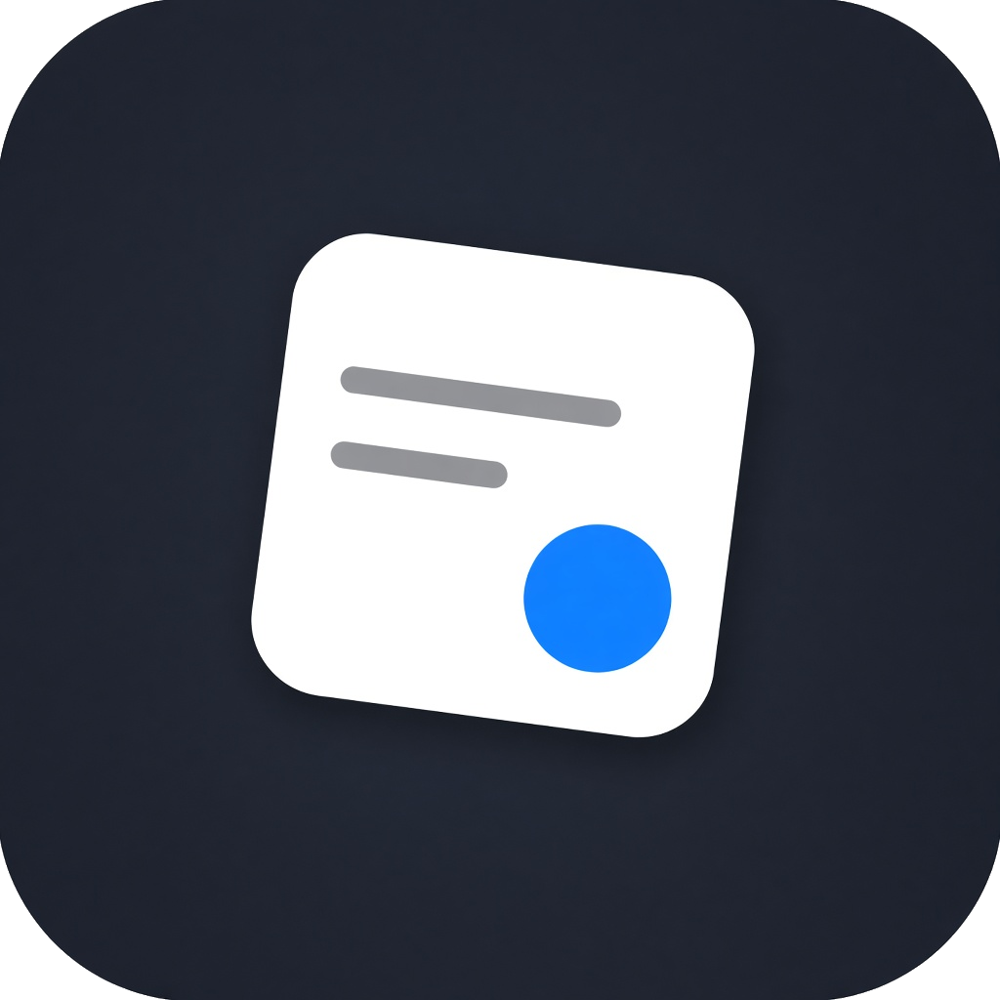

<div align="center">

<h1>TrackPurchase</h1>
<p><strong>Подписки под контролем.</strong><br />Регулярные расходы, балансы и ближайшие списания — в одном окне.</p>
<p>
<a href="https://github.com/Traums/TrackPurchase/releases/latest"></a>
<a href="https://github.com/Traums/TrackPurchase/actions/workflows/ci.yml"></a>


</p>
<p><a href="https://github.com/Traums/TrackPurchase/releases/latest"><strong>Скачать для Windows</strong></a> · <a href="docs/USER_GUIDE.md">Руководство</a> · <a href="https://github.com/Traums/TrackPurchase/issues/new/choose">Сообщить об ошибке</a></p>
</div>

---

## Меньше забытых подписок, больше ясности

TrackPurchase — локальное приложение для учёта регулярных платежей. Оно показывает месячные и годовые расходы, даты списаний и сервисы, баланс которых пора пополнить. Без регистрации и подключения банковских счетов.

## Возможности

- **Обзор расходов.** Месячный и годовой эквивалент стоимости активных подписок.
- **Ближайшие платежи.** Календарь текущего месяца и предупреждения о нехватке баланса.
- **Личный список.** Поиск, фильтры по категории и статусу, сортировка по дате, сумме и названию.
- **Гибкие подписки.** Неделя, месяц, квартал или год; RUB, USD и EUR; свои категории и цвета.
- **Отдельные балансы.** Остаток каждого сервиса учитывается отдельно. Быстрые действия появляются при наведении на строку.
- **Две темы.** Светлый и тёмный интерфейс с акцентом на ежемесячных расходах.
- **Данные рядом.** Локальные JSON-файлы, экспорт и импорт JSON / CSV, отмена последнего удаления.

## Установка

1. Откройте [последний релиз](https://github.com/Traums/TrackPurchase/releases/latest).
2. Скачайте архив **TrackPurchase-v0.1.0-windows-x64.zip** или архив актуальной версии.
3. Распакуйте и запустите **trackpurchase.exe**.

Установщик не нужен. Данные хранятся отдельно, в `%APPDATA%\TrackPurchase`. Приложение не подписано цифровым сертификатом: Windows может показать предупреждение о неизвестном издателе. Контрольная сумма архива опубликована рядом с релизом.

## Первые шаги

Нажмите **«+ Новая подписка»**, укажите стоимость, период и дату списания. Для сервисов с внутренним кошельком выберите **«С баланса»** и введите остаток. Наведите курсор на строку, чтобы пополнить баланс или поставить подписку с карты на паузу. Нажатие на строку открывает форму: там можно изменить любые поля, включая активность.

- `Ctrl+N` — новая подписка.
- `Ctrl+F` — поиск.
- `Esc` — закрыть форму или настройки.

[Полное руководство пользователя →](docs/USER_GUIDE.md)

## Сборка из исходников

Нужны Windows x64, стабильный Rust с MSVC toolchain, Visual Studio Build Tools с компонентами C++ и Windows SDK.

```powershell
git clone https://github.com/Traums/TrackPurchase.git
cd TrackPurchase
cargo run --locked
```

Оптимизированная сборка и проверка:

```powershell
cargo test --locked
cargo build --release --locked
.\target\release\trackpurchase.exe
```

[Устройство проекта и выпуск версий →](docs/DEVELOPMENT.md)

## Как считаются расходы

Итоги — эквиваленты стоимости активных подписок, а не история банковских операций. Валюты пересчитываются по ручным курсам из настроек. Приложение не выполняет реальные платежи и не загружает курсы из интернета. [Подробнее](docs/USER_GUIDE.md#расчёты-и-ограничения).

## Участие

Идеи и ошибки — в [Issues](https://github.com/Traums/TrackPurchase/issues/new/choose). Правила работы с кодом — в [CONTRIBUTING.md](CONTRIBUTING.md), история версий — в [CHANGELOG.md](CHANGELOG.md).

## Лицензирование

Лицензия исходного кода пока не выбрана. Публикация репозитория сама по себе не предоставляет разрешение на распространение или создание производных работ. Условия сторонних библиотек действуют отдельно; перед распространением своей сборки проверьте их лицензии, включая Slint.
